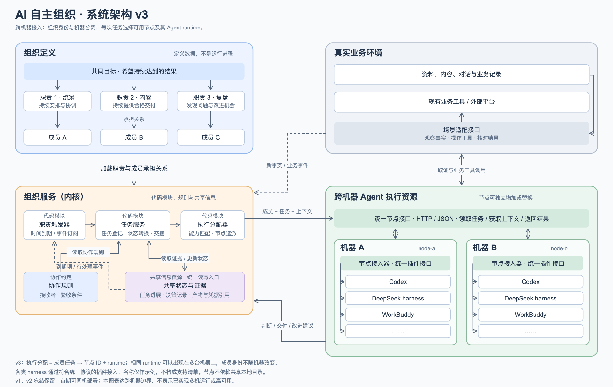

# Agent Federation

**让多个 AI 围绕持续目标，自主组织行动，并根据真实结果持续调整与改进。**

Agent Federation 探索一个建立在现有 Agent 之上的组织运行内核：让职责有人持续承担，让工作能够跨成员交接，让一次执行结束后，组织仍能根据目标、事实和反馈继续运行。

> 当前处于设计与 POC 准备阶段。仓库包含组织模型、架构设计和验证方案，尚无可运行实现。图中的 runtime 与机器是架构示例，不是已实现的兼容性清单。

## 为什么需要这一层

Codex 等 Agent 擅长完成一次任务。持续运营还需要回答：下一件事从哪里来？谁来承担？需要另一个成员配合时如何接续？结果如何改变下一轮行动？没有值得做的事情时，如何等待？

Agent Federation 负责这些跨任务、跨成员的组织机制。推理、工具调用和具体任务执行复用现有 Agent runtime，不另造一个通用 Agent。组织可以是一支内容运营团队、一个软件维护小组，或其他围绕持续目标工作的协作单元，不必是一家公司。

## 架构

[查看矢量图 SVG](docs/assets/architecture-v3.svg) · [架构与运行机制](docs/architecture.md)

- **组织定义**：目标、职责、成员及分配关系，表达组织为什么存在、持续承担什么。
- **组织运行内核**：职责触发器、任务服务、执行分配器，将时间与事件转为检查、任务与执行；协作规则规定交接方式，共享状态与证据保存实际进展和依据。
- **Agent 执行节点**：部署在一台或多台机器上，通过统一接口领取任务、准备上下文、调用 runtime、返回结果。
- **业务接入**：连接真实环境中的材料、工具与结果；业务判断由成员完成，确定性的状态与触发逻辑由程序承担。

职责、成员、runtime 和机器分别建模。复盘职责可以分配给某个成员，该成员本次使用 DeepSeek harness，下次也可以使用符合能力要求的 Codex。切换执行器不应改写职责或组织流程。Codex、DeepSeek harness、WorkBuddy 等通过适配器接入；具体兼容性需逐一实现验证。

## 什么构成一个组织

| 概念 | 含义 |
| --- | --- |
| 目标 | 持续追求的结果，而非一张待办清单 |
| 职责 | 跨任务持续承担的责任，即使当前没有任务也仍存在 |
| 成员 | 承担职责、拥有独立上下文与可追溯记录的协作身份 |
| 任务 | 有输入、负责人和完成条件的一次工作 |
| 共享状态与证据 | 当前进展、决定、交接关系与真实产物的引用 |
| 协作规则 | 谁接收交付、什么算完成，以及等待、退回与阻塞如何处理 |

成员不等于模型或进程，一次执行也不等于任务已经完成。这些概念是待验证的模型选择，不能因为像人类组织就假定它们必然必要。详见[组织模型与概念辨析](docs/organization-model.md)。

## 首个 POC：真实 X 运营团队

使用真实运营检验内核，设置五个固定成员：运营统筹、内容与发布、关系运营、评论与对话、运行复盘。初始计划前四个使用 Codex，复盘成员使用 DeepSeek harness；这是可替换配置，不是角色绑定。

一条代表性场景：评论成员发现材料缺口 → 内容成员补充材料 → 评论成员实际采用并回复 → 复盘成员从交接记录发现问题 → 统筹决定并落实小改进 → 后续运营检查效果并继续。

核心验证收敛为三个问题：

1. **能否持续接续？** 无需人逐次派活，能保留未完事项、按条件继续，也能合理等待。
2. **是否有效协作？** 从问题来源到交付、接收、实际采用都有证据，不能仅靠成员互相说“完成了”。
3. **能否从结果中改进？** 有依据地发现问题、实施最小调整、检查效果，再保留、修正或撤回；没有问题时允许不改。

另用小规模技术探针验证 runtime 替换与跨机器边界。启用时直接用于真实运营；历史回放补足现场未出现的情境，不代替真实运行。具体方案见 [POC 场景与验收](docs/poc.md)。

## 当前重点与边界

当前最值得解决的是持续运行的状态接续、异构成员之间的可靠交接，以及反馈如何变成有效后续工作。下一项设计重点是成员的最小执行合同：醒来拿到什么、结束交回什么、哪些状态必须留下、什么条件触发下一步。

首轮采用小型组织服务与独立执行节点，保留跨机器接口；暂不建设动态招聘、多机高可用、万能适配框架或大型管理后台。自主改进先覆盖职责说明、交付要求与操作步骤，不要求任意自主改写和发布整个系统。

## 文档与参与

- [组织模型与概念辨析](docs/organization-model.md)
- [架构、模块与运行机制](docs/architecture.md)
- [首个 POC：场景、验收与技术难点](docs/poc.md)
- [当前开放问题与状态](OPEN-QUESTIONS.md)

欢迎通过 Issue 提供具体协作案例、失败证据或对模型的反例。最有帮助的讨论是说明现有 Agent 已经能完成什么，以及组织接续究竟在哪一步断掉。当前尚无安装与运行命令。
