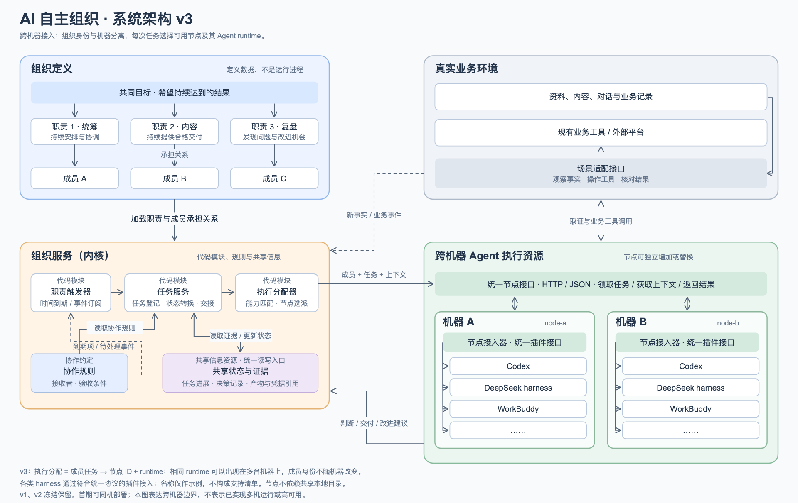

# 架构与运行机制

状态：V3 设计基线，未实现。图中模块表示逻辑职责，不要求拆成独立服务。

## 模块职责

| 实体 | 作用 |
| --- | --- |
| 职责触发器 | 读取到期项和事件，登记职责检查任务；不替成员决定业务行动 |
| 任务服务 | 保存任务、依赖与状态，办理交接、接收或退回；实际质量由接收成员或业务工具核验 |
| 执行分配器 | 根据必要能力与显式配置选择 runtime 和节点，创建执行记录；不制定经营策略 |
| 协作规则 | 配置或文档中的交接条件、接收者、完成要求与阻塞处理约定 |
| 共享状态与证据 | 当前进展、承接关系、决定、历史记录和产物引用的统一读写入口；底层可组合结构化存储、文档和业务接口 |
| 节点接入器与 runtime 适配器 | 领取任务、装配成员上下文、调用具体 harness，回传结果；不是新增组织成员 |
| 业务适配层 | 复用现有业务工具，将输入与实际结果转换为可引用证据 |

统筹也是成员，负责业务判断。成员可直接履责，不要求所有行动经过统筹。共享状态与证据不是单一“组织数据库”的同义词，更不能以 Agent 自述替代外部事实。

## 任务从哪里来

初始化时提供目标、职责、成员分配与检查条件。到期或事件触发后，程序登记检查任务；成员读取事实，决定创建工作、继续已有工作、等待或不行动。常规确定性任务也可由规则直接产生。

任务服务保存负责人、输入、依赖和完成条件。就绪任务交给执行分配器；执行节点领取并运行。成员提交后，接收者核验实际结果，再完成任务或退回。结果与事件释放依赖、触发复盘或安排下次检查。

完成任务不无条件触发新检查。重复事件合并，同一职责不反复创建相同检查，空闲不意味着必须找活。

## 状态与记录

任务核心状态为未分配、就绪、执行中、待接收、完成、等待、失败、结果未知。提交不等于完成；等待条件满足后可回到就绪。失败依据证据重试；结果未知先核对原执行和外部结果，避免重复动作。

保存 Member、Work、Run、Event，以及独立的职责、分配和协作配置。职责跨任务存在，成员跨 Run 存在；Run 记录实际 runtime、节点与执行状态。

## 最小执行合同（待细化）

输入包含成员、任务、执行 ID，职责与任务说明、必要能力、证据和产物引用。输出包含执行状态、结果引用、问题与交接请求。具体 JSON 字段尚未冻结。

runtime 的会话 ID、提示词形式与工具格式留在适配器中。切换执行器通过组织保存的材料接续，不假设私有聊天会话可迁移。能力要求按实际工具与节点判断，不按模型品牌猜测。

## 部署边界

第一版可用一个小型组织服务和独立节点程序；服务独占 SQLite 等状态存储，事务保存任务与待处理事件，暂不引入消息队列。技术语言尚未选定。

节点通过 HTTP/JSON 获取任务与材料、提交结果；引用不依赖控制端本地绝对路径，节点不直接打开组织状态库。领取记录执行归属与有效期，失联后先核实执行结果。

首轮可以同机部署，但必须实际走接口。跨机器能力需实际远程节点验证，不能仅由图推断。浏览器工具只在具备对应环境的节点可用。新增 harness 通过适配器扩展，图中的 Codex、DeepSeek harness、WorkBuddy 与省略号不代表现成支持。

## 图版本

V3 固定保留当前图示；后续修改另建版本。PNG 用于 README 展示，[SVG](assets/architecture-v3.svg)用于缩放与编辑。当前图表达设计，尚无运行结果。
