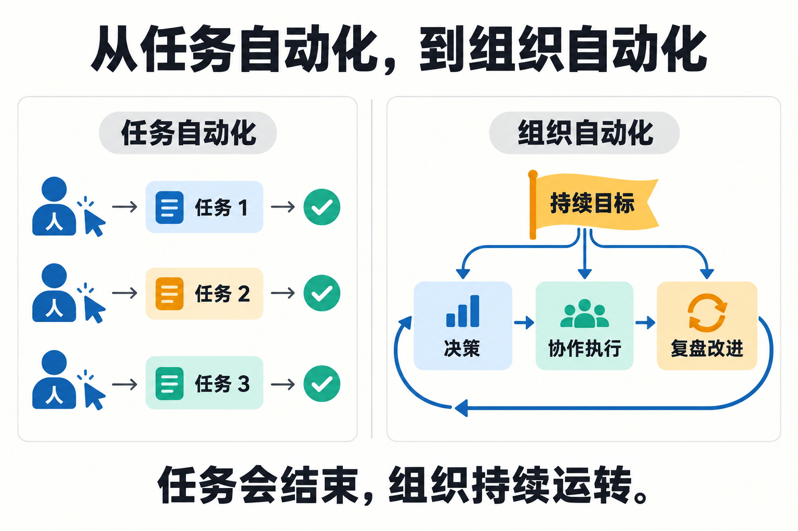
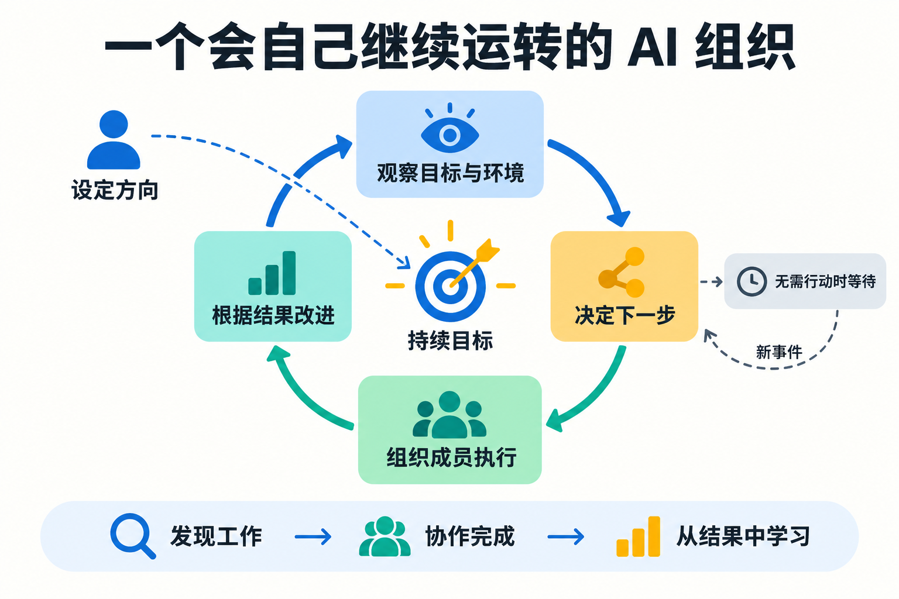
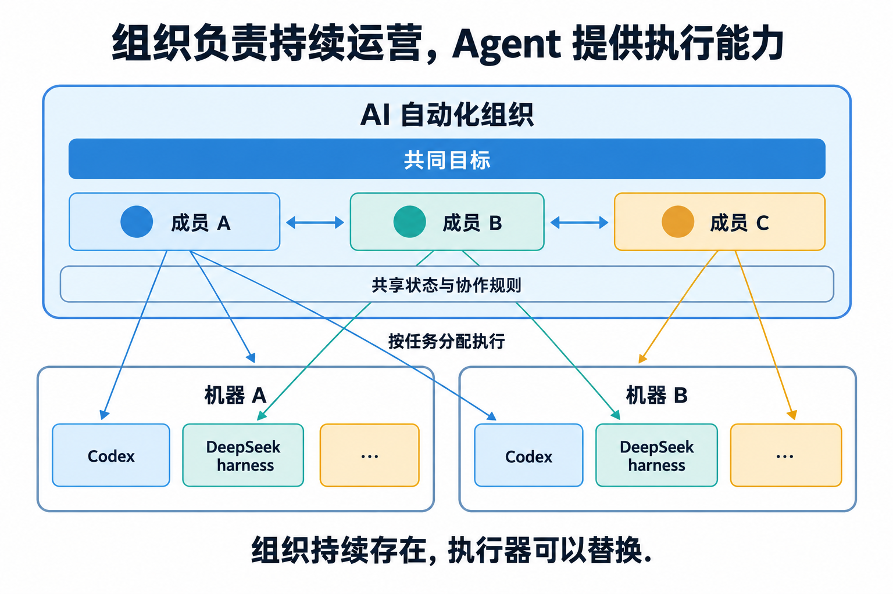

# AI 自动化组织：文章概念图解

2026-10-31，使用 Codex 内置 imagegen 生成。每张图解释一个观点，以平面图形、箭头和少量文字表达关系。属于概念示意，非功能截图或已实现能力证明。

## 从任务自动化，到组织自动化

强调一次任务完成与围绕目标持续运营的区别。左侧是人工反复发起任务的示例，不表示所有任务自动化都必须人工触发。

## 组织怎样自己继续运转

观察环境、决定行动、协作执行、根据结果改进；无需行动时等待新事件。

## 组织与 Agent 的关系

组织保存目标、成员关系与持续状态，按任务选择可用执行器。连线表示可选择的执行分配，不表示同一个任务必须广播执行。具体模块和协议以 [V3 架构](architecture.md)为准。

## 制作记录

风格：平面文章信息图，白底、蓝绿黄配色、清晰中文标题与关系箭头。提示词见[生成说明](assets/concepts/explainer-prompts.md)。此前未采用的建筑插画保留于[历史探索](concepts-illustration-history.md)。
