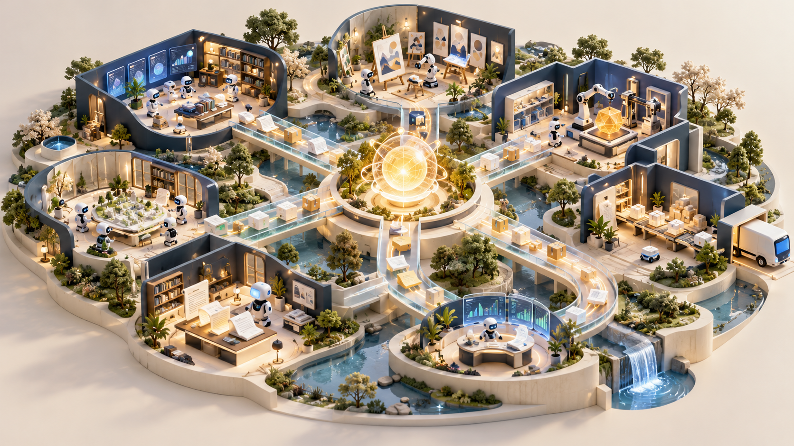
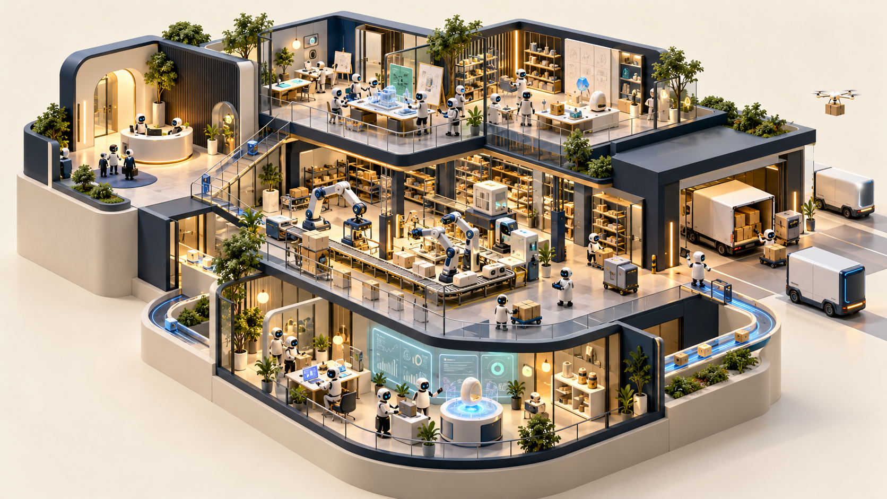
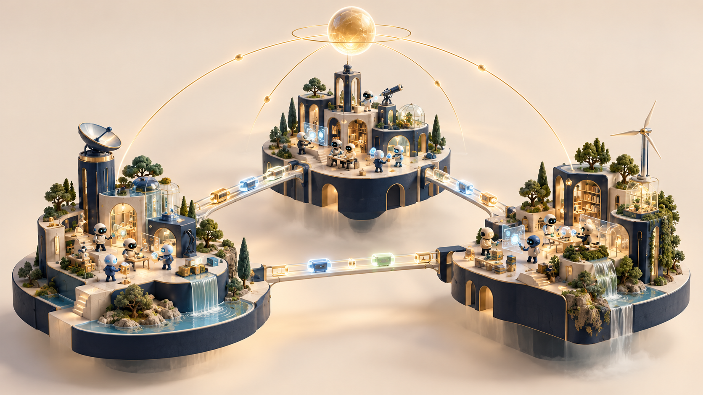

# Agent Federation 概念图

2026-10-31，使用 Codex 内置 imagegen 生成。风格：等距微缩建筑、象牙白与深蓝、玻璃通道与暖色照明。图中建筑、机器人与物流是组织协作的视觉隐喻，不代表产品界面或已实现能力。

## 自主组织

围绕共同目标，不同职能持续协作、交接和改进。适合作为项目整体愿景插画。



## 自动化公司

通过建筑剖面表达需求、研发、生产、交付和复盘的整体运转。实体生产与运输为概念隐喻，不限定产品业务领域。



## 分布式协作

不同节点通过任务与证据流连接，共同服务组织目标。岛屿和光桥表达跨机器协作。



## 生成提示词

每张独立生成，采用以下公共提示词，将主题与场景替换为后面的对应段落。

```text
Create one polished landscape 16:9 conceptual illustration for the open-source project Agent Federation. Theme: [theme]. [scene] Consistent art direction: premium editorial isometric miniature architecture, warm ivory matte background, deep navy structures, cobalt blue and mint accents with restrained amber highlights, tactile ceramic and frosted glass, precise elegant geometry, soft studio shadows, sophisticated product launch visual, highly legible overall composition, generous negative space, beautiful crafted detail. This is a future vision, not a screenshot or technical diagram. No text, no labels, no logos, no watermark, no neon cyberpunk, no generic brain icon. Full standalone image, not a collage.
```

### autonomous organization

```text
A beautiful miniature open architectural campus, several distinct specialized AI workspaces collaborating around a shared glowing mission core; tangible documents and products flowing between rooms, feedback paths loop back into a small improvement studio. Organization scale, coherent whole, no central humanoid boss.
```

### automated company

```text
A sophisticated miniature autonomous company shown as an architectural cutaway: customer needs enter reception, research and design atelier, production workshop, delivery dock, customer feedback and improvement laboratory all visibly connected. Tiny abstract AI agents operate different stations. Emphasize an entire continuously operating enterprise, not a chatbot.
```

### distributed federation

```text
Three distinct miniature architectural islands on separate physical computing plinths, with diverse small abstract AI agents in each, linked by elegant illuminated bridges transporting task and evidence capsules. A common organizational mission above binds the islands; distributed resources and shared purpose, not one giant central robot.
```
